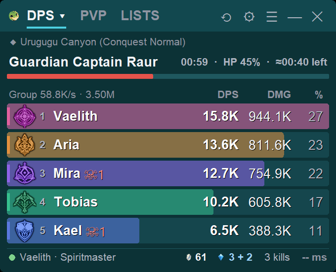
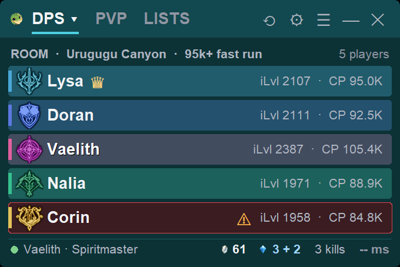
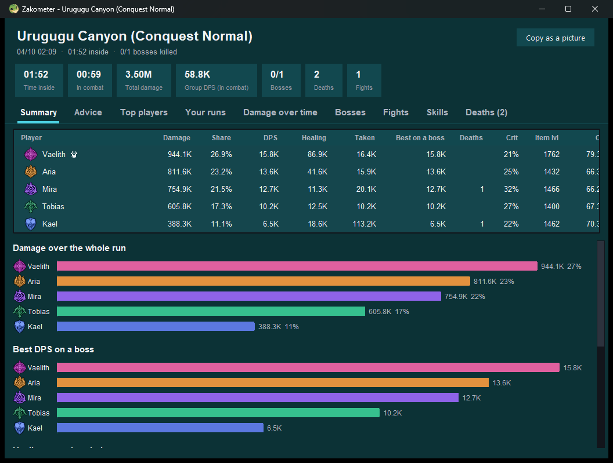
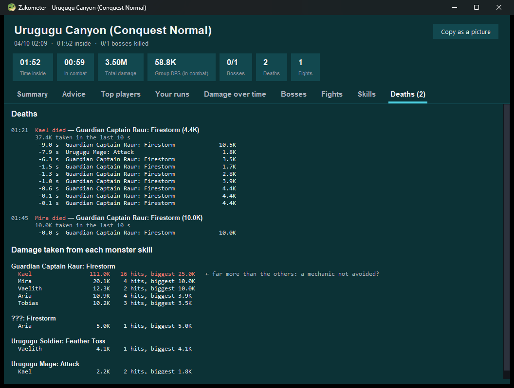
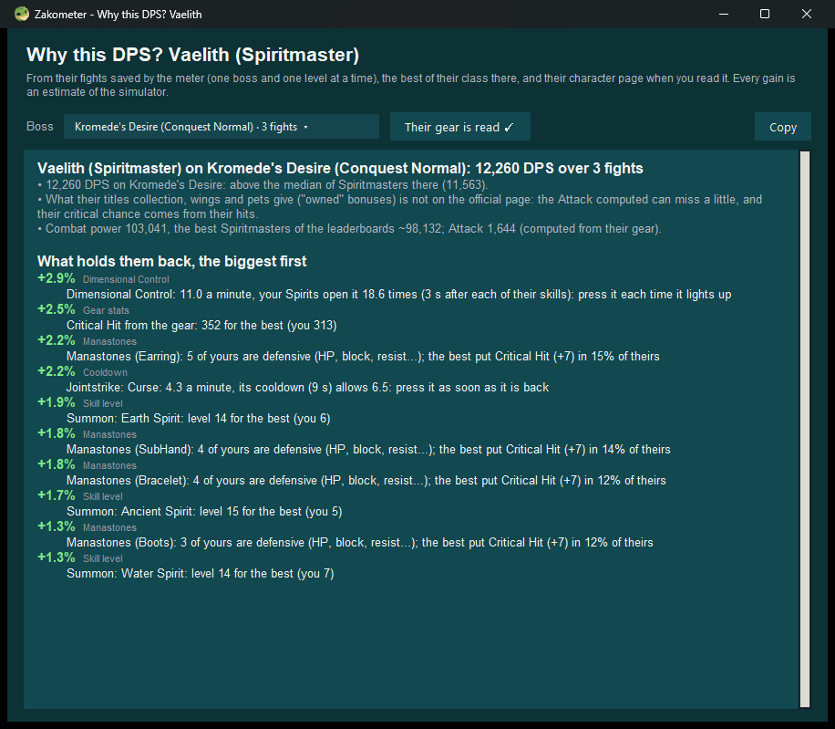
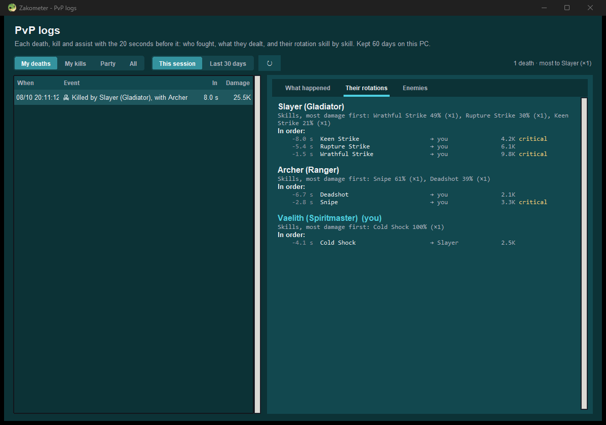
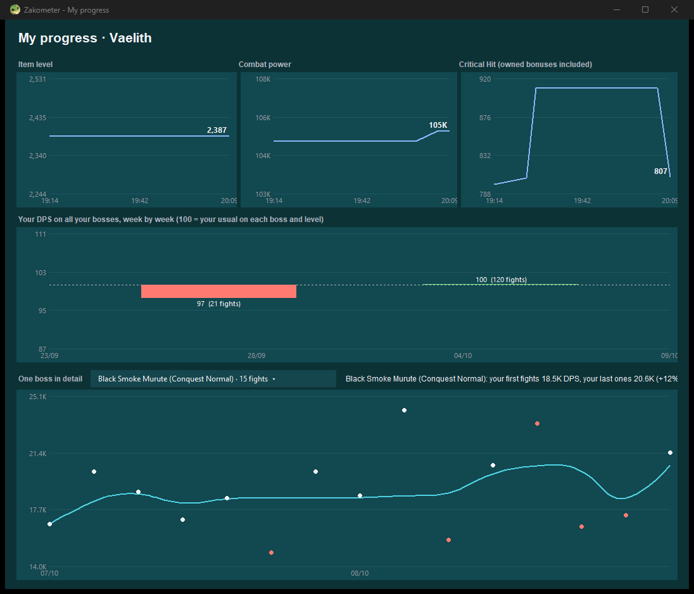

# Zakometer: a local DPS meter for Aion 2

> **⚠ Use at your own risk.** Zakometer is a third-party tool. It only *reads* the game's
> network traffic on your PC (like every DPS meter): it never touches the game, never
> injects anything, never automates anything. NCSoft has not banned personal meters; their
> warning (May 2026) was about tools that collect and publish other players' data without
> their consent. Zakometer shares your boss fights on its stats site, every player with
> their name, like the other meters' sites. Still, no third-party tool is risk-free, and
> NCSoft can change its rules at any time.
> Not affiliated with NCSoft.

**[⬇ Download the latest Zakometer.exe](https://github.com/zakariagharbi22091996-png/zakometer-releases/releases/latest)**

## What it does

- **Live overlay**: you and your party, damage / healing / damage taken, boss HP and time
  left, your resurrection stones, where you are (dungeon and mode, Transcendence, Nightmare
  level, Abyss, arena). Out of dungeons you see your group only, world bosses included (every
  player is still recorded: the event's summary lists them all). In dungeons the bars show
  the bosses (the trash phases on request).
- **Room check**: join a room and see who is in it before the run: class, item level,
  combat power, who leads. Anyone on your blacklist shows up in red.
- **Dungeon summary** when you leave: everyone's damage over the whole run, bosses, fights,
  skills, advice, and a **Deaths** tab: what killed each player in their last 10 s, and the
  damage everyone took from each boss skill (who keeps eating the mechanics). Nothing pops
  up during the run.
- **Why this DPS?**: right-click any player, or yourself: what holds them back, biggest first,
  each fix priced in % of DPS (rotation, skill levels), and the gear's next moves from the
  **Optimizer** of Zakometer Logs (replace, soul bind lines, enhance, with their cost). Works for
  every class.
- **My upgrade plan** (menu): the Optimizer on your character, with your Odyle: what to
  upgrade next, what your Kinah buys best, where to spend your Odyle, what a craft really costs.
- **My materials** (menu): your bag and your warehouse as the game sends them, priced on your
  server's market (prices: [Aion 2 Exchange](https://aion2.exchange), with its creator's
  permission), when to sell, and what they craft (each step's success, the 25 % combo).
- **PvP logs**: each death / kill / assist with the 20 s before it, and the enemies' rotation
  skill by skill.
- **Damage tests**: your DPS over an exact time on a dummy, with a sound at the start and the
  end, your critical / perfect / double / multi-hit rates, and for two tests: was the gap luck
  or real, and what changed between the two sets (skills, gear, combat speed).
- **Event alarms**: Shugo Festival, rifts, sieges, arena, Abyss bosses and the field bosses of
  your map (live times for your server), a few minutes before, each with its own sound.
- **My progress**: item level, combat power, critical hit, your DPS week by week, one boss
  in detail.
- Optional: a soft sound when a skill is ready (you pick the skills, the sound and the
  volume), buff and debuff uptime, blacklist / whitelist with your own notes, copy the
  overlay as a picture for Discord.

Comparisons are always like for like: same boss, same difficulty, same level (Nightmare 10
is never set against Nightmare 1, Conquest never against Exploration).

| | |
|---|---|
|  |  |
|  |  |
|  |  |

*Player names in the screenshots are changed.*

## Install

1. Download `Zakometer.exe` and run it. If Windows says "Windows protected your PC":
   *More info* → *Run anyway* (the file is not code-signed).
2. The first time, Zakometer offers to install **Npcap** (free, needed to read the network
   traffic): *Install Npcap* → Yes → *I Agree* → *Install*.
3. Play Aion 2 in windowed or borderless mode. Your character is recognised the next time
   you change zone or teleport.

## Privacy and Zakometer Logs

Your **boss fights** go to **[Zakometer Logs](https://zakometer.pages.dev)**, the free stats site
(rankings, classes, top 10, timers, every fight in detail) when they end: every player of
the fight with their name, class, damage, skills, deaths and combat power (rounded to 5K).
Turn the sharing off at any time: Settings → *Share my boss fights*.

Nothing else leaves your PC. Zakometer also goes online to check this page for a newer
version (nothing about you is sent; you can turn it off), to read the event times from
Zakometer Logs (your server's number only), when **you** open My materials (sent once to be
priced, never kept), and when **you** search a character, read a
player's gear (NCSoft's official site, and Zakometer Logs for the gear advice) or start a damage
test (your character's gear for the test).

## Updates

When a newer version is out, the overlay says so: menu ☰ → **Update** downloads it, closes
Zakometer, replaces the file and starts it again.
